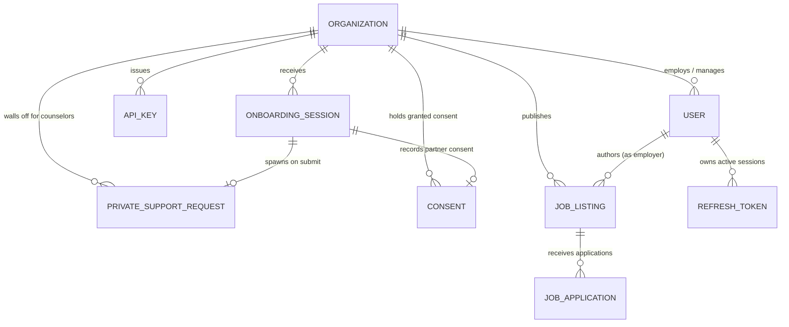

# Data Model & Schema Reference — Savanna Career Gateway

This document provides the definitive reference for the MongoDB database schemas, relationships, indexing strategies, and tenant-scoping mechanisms implemented across the platform.

---

## 1. Entity-Relationship Overview

---

## 2. Core Collections

### 2.1 `organizations`
Stores tenant profiles, accessibility settings, and multilingual branding configurations.

| Field | Type | Constraints | Description |
|---|---|---|---|
| `_id` | `ObjectId` | Primary Key | Unique tenant identifier |
| `name` | `String` | Required, trimmed, min: 2, max: 120 | Organization display name |
| `slug` | `String` | Required, unique, lowercase, indexed | URL-safe slug (e.g. `ethiopia-skills-hub`) |
| `branding` | `Object` | Subdocument | `logoUrl`, `theme`, `primaryColor`, `secondaryColor`, `accentColor`, `backgroundColor`, `customCss` |
| `settings` | `Object` | Subdocument | `supportedLanguages` (`['en', 'am', 'om']`), `defaultLanguage`, `accessibilityMode`, `allowGuestOnboarding` |
| `status` | `String` | Enum: `active`, `suspended`, `pending` | Account standing |
| `apiKeys` | `Array<ApiKey>` | Subdocuments | Opaque hashed API keys (`public_widget` and `secret_admin`) |
| `createdAt` / `updatedAt` | `Date` | Timestamp | Standard audit dates |

**Indexes:**
- `{ slug: 1 }` (unique)
- `{ 'apiKeys.keyHash': 1 }`
- `{ status: 1 }`

---

### 2.2 `users`
Represents platform administrators, organization staff, verified partners, and employers.

| Field | Type | Constraints | Description |
|---|---|---|---|
| `_id` | `ObjectId` | Primary Key | Unique user identifier |
| `email` | `String` | Required, unique, lowercase, trimmed | User email (indexed) |
| `passwordHash` | `String` | Required, `select: false` | 12-round bcrypt hash |
| `firstName` | `String` | Required, max: 60 | First name |
| `lastName` | `String` | Required, max: 60 | Family name |
| `role` | `String` | Enum | `PLATFORM_ADMIN`, `ORGANIZATION_ADMIN`, `ORGANIZATION_MEMBER`, `EMPLOYER`, `PARTNER` |
| `organizationId` | `ObjectId` | Ref: `Organization` | Required for non-platform admin users |
| `status` | `String` | Enum: `active`, `suspended`, `pending_verification` | User status |
| `lastLoginAt` | `Date` | Nullable | Last authenticated timestamp |

**Indexes:**
- `{ email: 1 }` (unique)
- `{ organizationId: 1, role: 1 }`

---

### 2.3 `refresh_tokens`
Maintains refresh token rotation families and tracks cryptographic reuse attempts.

| Field | Type | Constraints | Description |
|---|---|---|---|
| `_id` | `ObjectId` | Primary Key | Session token record |
| `userId` | `ObjectId` | Ref: `User`, Required, Indexed | Token owner |
| `organizationId` | `ObjectId` | Ref: `Organization` | Associated tenant |
| `tokenHash` | `String` | Required, unique, indexed | SHA-256 hash of opaque token |
| `family` | `String` | Required, indexed (UUID) | Token rotation chain identifier |
| `isRevoked` | `Boolean` | Default: `false`, Indexed | Marks token as consumed or invalidated |
| `expiresAt` | `Date` | Required, TTL index | Automatically cleared on expiry |
| `replacedByTokenHash` | `String` | Nullable | Successor token hash |

**Indexes:**
- `{ tokenHash: 1 }` (unique)
- `{ family: 1 }`
- `{ expiresAt: 1 }` (TTL: `expireAfterSeconds: 0`)

---

### 2.4 `onboarding_sessions`
Supports progressive, one-question-at-a-time onboarding, autosaving drafts, and no-document pathways.

| Field | Type | Constraints | Description |
|---|---|---|---|
| `sessionId` | `String` | Required, unique, indexed | Public session ID (`sess_...`) |
| `draftTokenHash` | `String` | Required, indexed | SHA-256 hash of recovery token (`dt_...`) |
| `organizationId` | `ObjectId` | Ref: `Organization` | Scoped tenant |
| `widgetKey` | `String` | Optional, indexed | Inbound widget identifier |
| `isSharedDevice` | `Boolean` | Default: `false` | Instructs device cleanup |
| `registrationMode` | `String` | Enum: `self`, `partner_assisted` | Registration pathway |
| `stepIndex` | `Number` | Default: `0` | Current question / step pointer |
| `stepResponses` | `Map` | Mixed | Per-step response map |
| `draft` | `Object` | Subdocument | `fullName`, `contactMethod`, `contactValue`, `identityRoute`, `identityReferenceNumber` (encrypted), `supportPreferences`, `supportNotes` |
| `status` | `String` | Enum: `in_progress`, `submitted`, `expired` | Session state |
| `expiresAt` | `Date` | Required, indexed | Session validity window (72 hours) |

**Indexes:**
- `{ sessionId: 1 }` (unique)
- `{ draftTokenHash: 1 }`
- `{ organizationId: 1, status: 1 }`

---

### 2.5 `private_support_requests`
**Strict Privacy Boundary Store**: Captures learner accommodation notes and preferences in an encrypted, walled-off database collection completely inaccessible to employers.

| Field | Type | Constraints | Description |
|---|---|---|---|
| `_id` | `ObjectId` | Primary Key | Support request record |
| `sessionReference` | `String` | Required, indexed | Pseudonymized reference |
| `organizationId` | `ObjectId` | Ref: `Organization`, Indexed | Tenant counselor ownership |
| `learnerName` | `String` | Trimmed | Display name for counselor |
| `contactMethod` | `String` | Phone / Email | Contact route |
| `contactValue` | `String` | Encrypted / Trimmed | Contact value |
| `supportPreferences` | `[String]` | Array | e.g. `flexible_scheduling`, `sign_language` |
| `encryptedNotes` | `String` | Required (AES-256-GCM) | Detailed accommodation narrative |
| `status` | `String` | Enum: `pending_review`, `assigned`, `addressed` | Support fulfillment state |

---

### 2.6 `consents`
Records explicit, revocable user and partner consent in accordance with safeguarding principles.

| Field | Type | Constraints | Description |
|---|---|---|---|
| `_id` | `ObjectId` | Primary Key | Consent audit record |
| `learnerId` | `String` | Optional, indexed | Pseudonymized ID |
| `learnerIdHash` | `String` | Indexed | Deterministic SHA-256 search hash |
| `sessionReference` | `String` | Required, indexed | Session token reference |
| `purpose` | `String` | Enum | `career_guidance`, `data_sharing_with_employers`, `accessibility_accommodations`, `voice_profile_storage`, `general_onboarding` |
| `grantedToOrganizationId`| `ObjectId` | Ref: `Organization` | Scoped tenant |
| `timestamp` | `Date` | Default: `Date.now` | Grant timestamp |
| `revokedAt` | `Date` | Nullable, Indexed | Timestamp of revocation |
| `metadata` | `Object` | Subdocument | `ipHash` (SHA-256 hashed IP for privacy), `userAgent`, `consentTextVersion`, `specificPermissions` |

**Compound Indexes:**
- `{ sessionReference: 1, purpose: 1, grantedToOrganizationId: 1, revokedAt: 1 }`
- `{ learnerIdHash: 1, purpose: 1, grantedToOrganizationId: 1, revokedAt: 1 }`

---

### 2.7 `job_listings`
Accessible job board postings featuring granular workplace accommodation descriptions.

| Field | Type | Constraints | Description |
|---|---|---|---|
| `_id` | `ObjectId` | Primary Key | Job identifier |
| `employerId` | `ObjectId` | Ref: `User`, Indexed | Employer account owner |
| `organizationId` | `ObjectId` | Ref: `Organization`, Indexed | Tenant context |
| `title` | `String` | Required, indexed | Job title |
| `organization` | `String` | Required, indexed | Hiring company name |
| `location` | `String` | Required | Physical or remote location |
| `isRemote` | `Boolean` | Default: `false`, Indexed | Remote status |
| `employmentType` | `String` | Enum | `Full-time`, `Part-time`, `Apprenticeship`, `Contract`, `Fellowship` |
| `descriptionSummary` | `String` | Required | Role overview |
| `requiredSkills` | `[String]` | Array | Required competencies |
| `accommodationCategories`| `[String]` | Indexed | Category tags for search |
| `accommodationsOffered` | `[String]` | Array | Plain-language adjustments |
| `accommodationDetails` | `Object` | Subdocument | Details for work environment, tech, interviews, application process |
| `status` | `String` | Enum: `published`, `draft`, `archived`, `closed` | Listing state |

---

### 2.8 `job_applications`
Applicant submissions linking jobseekers to job listings with strict privacy controls.

| Field | Type | Constraints | Description |
|---|---|---|---|
| `_id` | `ObjectId` | Primary Key | Application identifier |
| `jobId` | `ObjectId` | Ref: `JobListing`, Indexed | Target job listing |
| `applicantName` | `String` | Required, trimmed | Applicant name |
| `contactValue` | `String` | Required, trimmed | Email or phone |
| `relevantExperience` | `String` | Text | Background summary |
| `shareAccommodationRequest` | `Boolean` | Default: `false` | Whether candidate requested sharing |
| `accommodationRequestNote` | `String` | Private by default | Private note (masked without consent) |
| `explicitConsentToShare` | `Boolean` | Default: `false` | Must be `true` for employer visibility |
| `status` | `String` | Enum: `submitted`, `in_review`, `shortlisted`, `rejected` | Application progress |
| `statusHistory` | `Array` | Subdocuments | Timeline of status changes |
